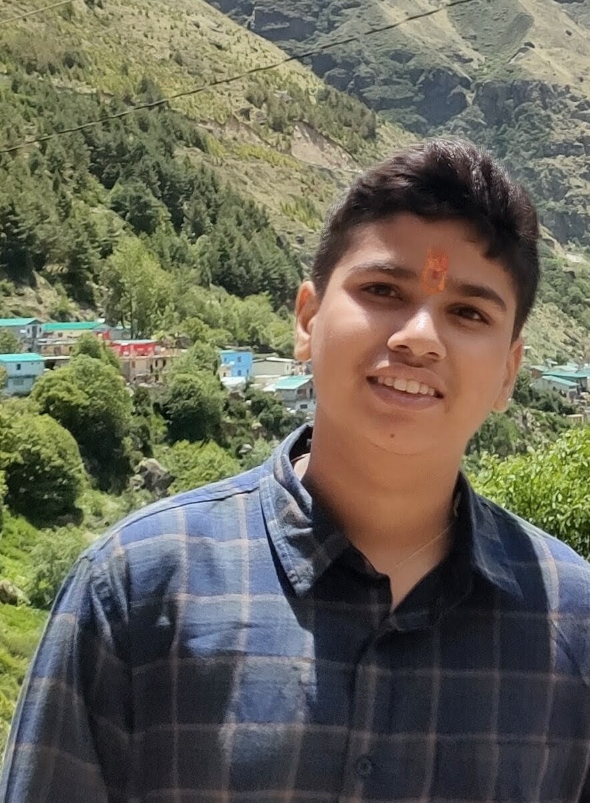

<!DOCTYPE html>
<!-- saved from url=(0039)https://vn9th.github.io/VidyaNirman9th/ -->
<html lang="en" class="scroll-smooth"><head><meta http-equiv="Content-Type" content="text/html; charset=UTF-8">
    
    <meta name="viewport" content="width=device-width, initial-scale=1.0">
    <title>Vidya Nirman | विद्या निर्माण - Class 9th Interactive Portal</title>
    <link rel="icon" type="image/png" href="./Vidya Nirman _ विद्या निर्माण - Class 9th Interactive Portal_files/logo.png">
    <!-- Tailwind CSS CDN -->
    
    
    <!-- FontAwesome Icons CDN -->
    <link rel="stylesheet" href="./Vidya Nirman _ विद्या निर्माण - Class 9th Interactive Portal_files/all.min.css">
    
    <!-- Google Fonts: Cinzel, Noto Serif Devanagari, Plus Jakarta Sans -->
    <link rel="preconnect" href="https://fonts.googleapis.com/">
    <link rel="preconnect" href="https://fonts.gstatic.com/" crossorigin="">
    <link href="./Vidya Nirman _ विद्या निर्माण - Class 9th Interactive Portal_files/css2" rel="stylesheet">

    
</head>
<body class="relative min-h-screen jali-pattern selection:bg-amber-500 selection:text-red-950">

    <!-- Floating Golden Spark & Ember Particles Canvas -->
    <canvas id="emberCanvas" class="fixed inset-0 pointer-events-none z-0 opacity-70" width="1024" height="641"></canvas>

    <!-- Traditional Decorative Watermark Mandalas -->
    

        <svg class="w-[700px] h-[700px] text-amber-400 spin-slow" viewBox="0 0 100 100" fill="currentColor">
            <path d="M50 0 L55 35 L90 10 L65 45 L100 50 L65 55 L90 90 L55 65 L50 100 L45 65 L10 90 L35 55 L0 50 L35 45 L10 10 L45 35 Z"></path>
            <circle cx="50" cy="50" r="30" fill="none" stroke="currentColor" stroke-width="2"></circle>
            <circle cx="50" cy="50" r="20" fill="none" stroke="currentColor" stroke-width="1" stroke-dasharray="2 2"></circle>
        </svg>
    

    

        <svg class="w-[700px] h-[700px] text-amber-400 spin-slow-reverse" viewBox="0 0 100 100" fill="currentColor">
            <path d="M50 0 L55 35 L90 10 L65 45 L100 50 L65 55 L90 90 L55 65 L50 100 L45 65 L10 90 L35 55 L0 50 L35 45 L10 10 L45 35 Z"></path>
            <circle cx="50" cy="50" r="35" fill="none" stroke="currentColor" stroke-width="1.5"></circle>
        </svg>
    

    <!-- Navigation Header -->
    <header class="sticky top-0 z-50 bg-[#0F0103]/90 backdrop-blur-md border-b border-amber-500/30 transition-all duration-300">
        

            
            <!-- Brand Logo & Devanagari Shloka -->
            <a href="https://vn9th.github.io/VidyaNirman9th/#home" class="flex items-center gap-3.5 group">
                

                    

                        
                    

                    <svg class="absolute inset-0 w-12 h-12 text-amber-400/40 spin-slow pointer-events-none" viewBox="0 0 100 100">
                        <circle cx="50" cy="50" r="48" fill="none" stroke="currentColor" stroke-width="2" stroke-dasharray="6 4"></circle>
                    </svg>
                

                

                    <h1 class="font-cinzel text-2xl font-black tracking-wider text-gold-gradient leading-none">VIDYA NIRMAN</h1>
                    सा विद्या या विमुक्तये
                

            </a>

            <!-- Desktop Menu Links -->
            <nav class="hidden lg:flex items-center space-x-6 text-xs font-bold uppercase tracking-wider">
                <a href="https://vn9th.github.io/VidyaNirman9th/#home" class="text-amber-100 hover:text-amber-400 transition-colors flex items-center gap-1.5"><i class="fa-solid fa-house text-amber-400"></i> Home</a>
                <a href="https://vn9th.github.io/VidyaNirman9th/#portals" class="text-amber-100 hover:text-amber-400 transition-colors flex items-center gap-1.5"><i class="fa-solid fa-book-open text-amber-400"></i> Learning Portals</a>
                <a href="https://vn9th.github.io/VidyaNirman9th/#quests" class="text-amber-100 hover:text-amber-400 transition-colors flex items-center gap-1.5"><i class="fa-solid fa-trophy text-amber-400"></i> Quest Arenas</a>
                <a href="https://vn9th.github.io/VidyaNirman9th/#directory" class="text-amber-100 hover:text-amber-400 transition-colors flex items-center gap-1.5"><i class="fa-solid fa-list-check text-amber-400"></i> Direct Links</a>
                <a href="https://vn9th.github.io/VidyaNirman9th/#founders" class="text-amber-100 hover:text-amber-400 transition-colors flex items-center gap-1.5"><i class="fa-solid fa-users text-amber-400"></i> Founders</a>
                <a href="https://vn9th.github.io/VidyaNirman9th/#notices" class="text-amber-100 hover:text-amber-400 transition-colors flex items-center gap-1.5"><i class="fa-solid fa-bullhorn text-amber-400"></i> Notices</a>
            </nav>

            <!-- Grand Quest Action Button -->
            

                <a href="https://vn9th.github.io/VidyaNirman9th/grand-quest.html" class="hidden sm:inline-flex items-center gap-2 px-4 py-2 rounded-full bg-gradient-to-r from-amber-500 via-yellow-400 to-amber-600 text-slate-950 font-black text-xs uppercase tracking-wider shadow-lg shadow-amber-500/25 hover:scale-105 transition-all">
                    <i class="fa-solid fa-crown text-amber-950"></i>
                    Grand Quest
                </a>

                <button id="mobileMenuBtn" class="lg:hidden text-amber-400 p-2.5 rounded-lg bg-amber-500/10 hover:bg-amber-500/20 border border-amber-500/30">
                    <i class="fa-solid fa-bars text-xl"></i>
                </button>
            

        

        <!-- Mobile Navigation Drawer -->
        

            <a href="https://vn9th.github.io/VidyaNirman9th/#home" class="mobile-link block text-amber-100 hover:text-amber-400 py-1 font-semibold"><i class="fa-solid fa-house mr-2 text-amber-400"></i> Home</a>
            <a href="https://vn9th.github.io/VidyaNirman9th/#portals" class="mobile-link block text-amber-100 hover:text-amber-400 py-1 font-semibold"><i class="fa-solid fa-book-open mr-2 text-amber-400"></i> Learning Portals</a>
            <a href="https://vn9th.github.io/VidyaNirman9th/#quests" class="mobile-link block text-amber-100 hover:text-amber-400 py-1 font-semibold"><i class="fa-solid fa-trophy mr-2 text-amber-400"></i> Quest Arenas</a>
            <a href="https://vn9th.github.io/VidyaNirman9th/grand-quest.html" class="mobile-link block text-amber-300 font-bold py-1"><i class="fa-solid fa-crown mr-2 text-amber-400"></i> GRAND-QUEST Championship</a>
            <a href="https://vn9th.github.io/VidyaNirman9th/#directory" class="mobile-link block text-amber-100 hover:text-amber-400 py-1 font-semibold"><i class="fa-solid fa-list-check mr-2 text-amber-400"></i> Portal Directory</a>
            <a href="https://vn9th.github.io/VidyaNirman9th/#founders" class="mobile-link block text-amber-100 hover:text-amber-400 py-1 font-semibold"><i class="fa-solid fa-users mr-2 text-amber-400"></i> Leadership &amp; Founders</a>
            <a href="https://vn9th.github.io/VidyaNirman9th/#notices" class="mobile-link block text-amber-100 hover:text-amber-400 py-1 font-semibold"><i class="fa-solid fa-bullhorn mr-2 text-amber-400"></i> Notice Board</a>
        

    </header>

    <!-- Hero Section -->
    <section id="home" class="relative pt-10 pb-16 md:pt-16 md:pb-24 overflow-hidden z-10">
        

            
            <!-- Traditional Shloka Banner Crest -->
            

                <i class="fa-solid fa-om text-amber-400 text-base"></i>
                "विद्यां ददाति विनयं, विनयाद् याति पात्रताम्"
                <i class="fa-solid fa-dharmachakra text-amber-400 text-base"></i>
            

            <h1 class="font-cinzel text-4xl sm:text-6xl md:text-7xl font-black text-gold-gradient tracking-tight leading-none mb-3">
                VIDYA NIRMAN
            </h1>

            

                विद्या निर्माण — Class 9th Interactive Learning Ecosystem
            

            

                Welcome to the digital Gurukul designed specifically for Class 9th CBSE &amp; ICSE students. Explore dedicated subject learning portals and compete in interactive Quest Arenas engineered by founders <strong class="text-amber-300">Anmol Tiwari</strong> and <strong class="text-amber-300">Amrit Singh</strong>.
            

            <!-- Quick Access Gateway Ribbon -->
            

                
                <a href="https://vn9th.github.io/VidyaNirman9th/vidyanirman-bio.html" class="p-3 rounded-xl bg-maroon-card border-gold-glow hover:bg-amber-950/60 transition-all text-center group">
                    <i class="fa-solid fa-dna text-emerald-400 text-lg mb-1 group-hover:scale-110 transition-transform block"></i>
                    VN Bio
                </a>

                <a href="https://vn9th.github.io/VidyaNirman9th/physics.html" class="p-3 rounded-xl bg-maroon-card border-gold-glow hover:bg-amber-950/60 transition-all text-center group">
                    <i class="fa-solid fa-atom text-cyan-400 text-lg mb-1 group-hover:scale-110 transition-transform block"></i>
                    VN Physics
                </a>

                <a href="https://vn9th.github.io/VidyaNirman9th/vidyanirman-chemistry.html" class="p-3 rounded-xl bg-maroon-card border-gold-glow hover:bg-amber-950/60 transition-all text-center group">
                    <i class="fa-solid fa-flask text-amber-400 text-lg mb-1 group-hover:scale-110 transition-transform block"></i>
                    VN Chem
                </a>

                <a href="https://vn9th.github.io/VidyaNirman9th/bio-quest.html" class="p-3 rounded-xl bg-maroon-card border-gold-glow hover:bg-amber-950/60 transition-all text-center group">
                    <i class="fa-solid fa-vial text-emerald-300 text-lg mb-1 group-hover:scale-110 transition-transform block"></i>
                    Bio Quest
                </a>

                <a href="https://vn9th.github.io/VidyaNirman9th/physics-quest.html" class="p-3 rounded-xl bg-maroon-card border-gold-glow hover:bg-amber-950/60 transition-all text-center group">
                    <i class="fa-solid fa-bolt text-cyan-300 text-lg mb-1 group-hover:scale-110 transition-transform block"></i>
                    Phys Quest
                </a>

                <a href="https://vn9th.github.io/VidyaNirman9th/chemistry-quest.html" class="p-3 rounded-xl bg-maroon-card border-gold-glow hover:bg-amber-950/60 transition-all text-center group">
                    <i class="fa-solid fa-fire-burner text-amber-300 text-lg mb-1 group-hover:scale-110 transition-transform block"></i>
                    Chem Quest
                </a>

                <a href="https://vn9th.github.io/VidyaNirman9th/grand-quest.html" class="p-3 rounded-xl bg-gradient-to-b from-amber-500/30 to-amber-700/30 border border-amber-400 hover:scale-105 transition-all text-center group col-span-2 sm:col-span-1">
                    <i class="fa-solid fa-trophy text-yellow-300 text-lg mb-1 group-hover:scale-110 transition-transform block animate-bounce"></i>
                    Grand Quest
                </a>

            

        

    </section>

    <!-- Notice Board Marquee -->
    <section id="notices" class="py-3 bg-[#220308] border-y border-amber-500/30 relative z-10 overflow-hidden">
        

            

                <i class="fa-solid fa-bullhorn animate-bounce"></i> Live Updates
            

            
            

                

                    🏆 <strong class="text-amber-400">GRAND-QUEST Championship:</strong> Registrations live for Class 9th All-Subject Championship Quiz! (<a href="https://vn9th.github.io/VidyaNirman9th/grand-quest.html" class="underline text-yellow-300">Enter Arena</a>)
                    🧬 <strong class="text-amber-400">VIDYANIRMAN BIO:</strong> Cell Organelles 3D Visualizer &amp; Tissues module updated (<a href="https://vn9th.github.io/VidyaNirman9th/vidyanirman-bio.html" class="underline text-yellow-300">Open Bio Portal</a>)
                    ⚛️ <strong class="text-amber-400">VIDYANIRMAN PHYSICS:</strong> Newton's Motion Laws &amp; Gravitation numericals uploaded (<a href="https://vn9th.github.io/VidyaNirman9th/physics.html" class="underline text-yellow-300">Open Physics Portal</a>)
                    🧪 <strong class="text-amber-400">VIDYANIRMAN CHEMISTRY:</strong> Mole Concept &amp; Bohr Model interactive notes live (<a href="https://vn9th.github.io/VidyaNirman9th/vidyanirman-chemistry.html" class="underline text-yellow-300">Open Chem Portal</a>)
                

            

        

    </section>

    <!-- GRAND QUEST Spotlight Hero Banner -->
    <section class="py-12 relative z-10">
        

            

                
                

                

                    

                        

                            <i class="fa-solid fa-crown text-amber-400"></i> The Ultimate Arena
                        

                        <h2 class="font-cinzel text-3xl sm:text-4xl font-black text-gold-gradient leading-tight">
                            GRAND-QUEST CHAMPIONSHIP
                        </h2>
                        

                            Test your complete Class 9th mastery across Biology, Physics, and Chemistry in one comprehensive timer-driven tournament arena. Win certificates, top the state leaderboard, and prove your academic excellence.
                        

                        

                            
                                <i class="fa-solid fa-layer-group text-amber-400 mr-1"></i> Covers Bio, Phys &amp; Chem
                            
                            
                                <i class="fa-solid fa-stopwatch text-amber-400 mr-1"></i> Timed Adaptive Battle
                            
                        

                    

                    

                        <a href="https://vn9th.github.io/VidyaNirman9th/grand-quest.html" class="w-full sm:w-auto px-8 py-4 rounded-2xl bg-gold-gradient text-slate-950 font-black text-sm uppercase tracking-wider shadow-xl shadow-amber-500/30 hover:scale-105 active:scale-95 transition-all flex items-center justify-center gap-2">
                            Enter Grand-Quest
                            <i class="fa-solid fa-arrow-right"></i>
                        </a>
                        <button onclick="openPortalModal('GRAND-QUEST Championship', 'grand-quest.html', 'All-Subject Championship Quiz covering Biology, Physics, and Chemistry for Class 9th.')" class="w-full sm:w-auto px-6 py-4 rounded-2xl bg-amber-950/80 text-amber-200 border border-amber-500/40 hover:border-amber-300 text-xs font-bold transition-all">
                            <i class="fa-solid fa-magnifying-glass mr-1"></i> Inspect Link
                        </button>
                    

                

            

        

    </section>

    <!-- Learning Portals Section (VIDYANIRMAN BIO, PHYSICS, CHEMISTRY) -->
    <section id="portals" class="py-16 relative z-10 bg-gradient-to-b from-[#0F0103] via-[#220308] to-[#0F0103] border-t border-amber-500/20">
        

            
            

                Interactive Syllabi
                <h2 class="font-cinzel text-3xl sm:text-4xl font-black text-gold-gradient mt-2">Vidya Nirman Learning Portals</h2>
                

                
Structured concept modules, 3D visualizers, formula sheets, and chapter summaries designed for Class 9th success.

            

            

                
                <!-- PORTAL 1: VIDYANIRMAN BIO -->
                

                    

                        

                            CLASS 9 BIOLOGY
                            <i class="fa-solid fa-dna text-emerald-400 text-2xl group-hover:rotate-12 transition-transform"></i>
                        

                        <h3 class="font-cinzel text-xl font-bold text-amber-100 mb-2">VIDYANIRMAN BIO</h3>
                        

                            Deep dive into Class 9th Life Sciences: Cell Structure &amp; Functions, Plant and Animal Tissues, Improvement in Food Resources, and Biodiversity.
                        

                        <ul class="space-y-2.5 mb-8 text-xs text-slate-300">
                            <li class="flex items-center gap-2"><i class="fa-solid fa-check text-emerald-400 text-[10px]"></i> Interactive Organelle Diagrams</li>
                            <li class="flex items-center gap-2"><i class="fa-solid fa-check text-emerald-400 text-[10px]"></i> Tissue Classification Maps</li>
                            <li class="flex items-center gap-2"><i class="fa-solid fa-check text-emerald-400 text-[10px]"></i> NCERT Practice Revision Guides</li>
                        </ul>
                    

                    

                        <a href="https://vn9th.github.io/VidyaNirman9th/vidyanirman-bio.html" class="w-full py-3 px-4 rounded-xl bg-gradient-to-r from-emerald-600 to-emerald-800 hover:from-emerald-500 hover:to-emerald-700 text-white font-bold text-xs uppercase tracking-wider transition-all flex items-center justify-center gap-2 shadow-lg">
                            Open Vidyanirman Bio
                            <i class="fa-solid fa-arrow-right"></i>
                        </a>
                        <button onclick="openPortalModal('VIDYANIRMAN BIO', 'vidyanirman-bio.html', 'Class 9th Biology Learning Portal featuring Cell Organelles, Tissues, and Bio Concept Maps.')" class="w-full py-2 px-3 rounded-lg bg-amber-950/60 text-amber-300 text-[11px] font-semibold hover:bg-amber-900/60 transition-colors">
                            <i class="fa-solid fa-circle-info mr-1"></i> Preview Portal Details
                        </button>
                    

                

                <!-- PORTAL 2: VIDYANIRMAN PHYSICS -->
                

                    

                        

                            CLASS 9 PHYSICS
                            <i class="fa-solid fa-atom text-cyan-400 text-2xl group-hover:spin-slow transition-transform"></i>
                        

                        <h3 class="font-cinzel text-xl font-bold text-amber-100 mb-2">VIDYANIRMAN PHYSICS</h3>
                        

                            Master Class 9th Physics: Distance &amp; Displacement, Motion Graphs, Newton's Laws of Motion, Universal Gravitation, Work, Power &amp; Sound Waves.
                        

                        <ul class="space-y-2.5 mb-8 text-xs text-slate-300">
                            <li class="flex items-center gap-2"><i class="fa-solid fa-check text-cyan-400 text-[10px]"></i> Numerical Problem Solver Guides</li>
                            <li class="flex items-center gap-2"><i class="fa-solid fa-check text-cyan-400 text-[10px]"></i> Kinematic Graph Visualizers</li>
                            <li class="flex items-center gap-2"><i class="fa-solid fa-check text-cyan-400 text-[10px]"></i> Gravitation Formula Sheets</li>
                        </ul>
                    

                    

                        <a href="https://vn9th.github.io/VidyaNirman9th/physics.html" class="w-full py-3 px-4 rounded-xl bg-gradient-to-r from-cyan-600 to-cyan-800 hover:from-cyan-500 hover:to-cyan-700 text-white font-bold text-xs uppercase tracking-wider transition-all flex items-center justify-center gap-2 shadow-lg">
                            Open Vidyanirman Physics
                            <i class="fa-solid fa-arrow-right"></i>
                        </a>
                        <button onclick="openPortalModal('VIDYANIRMAN PHYSICS', 'vidyanirman-physics.html', 'Class 9th Physics Learning Portal with Kinematics, Dynamics, and Gravitation modules.')" class="w-full py-2 px-3 rounded-lg bg-amber-950/60 text-amber-300 text-[11px] font-semibold hover:bg-amber-900/60 transition-colors">
                            <i class="fa-solid fa-circle-info mr-1"></i> Preview Portal Details
                        </button>
                    

                

                <!-- PORTAL 3: VIDYANIRMAN CHEMISTRY -->
                

                    

                        

                            CLASS 9 CHEMISTRY
                            <i class="fa-solid fa-flask text-amber-400 text-2xl group-hover:scale-110 transition-transform"></i>
                        

                        <h3 class="font-cinzel text-xl font-bold text-amber-100 mb-2">VIDYANIRMAN CHEMISTRY</h3>
                        

                            Unlock Matter in Our Surroundings, Is Matter Around Us Pure, Atoms &amp; Molecules, Mole Concept Calculations, and Bohr Atomic Models.
                        

                        <ul class="space-y-2.5 mb-8 text-xs text-slate-300">
                            <li class="flex items-center gap-2"><i class="fa-solid fa-check text-amber-400 text-[10px]"></i> Interactive Periodic Table Directory</li>
                            <li class="flex items-center gap-2"><i class="fa-solid fa-check text-amber-400 text-[10px]"></i> Mole Concept Step-by-Step Solvers</li>
                            <li class="flex items-center gap-2"><i class="fa-solid fa-check text-amber-400 text-[10px]"></i> Atomic Structure Orbit Models</li>
                        </ul>
                    

                    

                        <a href="https://vn9th.github.io/VidyaNirman9th/vidyanirman-chemistry.html" class="w-full py-3 px-4 rounded-xl bg-gradient-to-r from-amber-600 to-amber-800 hover:from-amber-500 hover:to-amber-700 text-white font-bold text-xs uppercase tracking-wider transition-all flex items-center justify-center gap-2 shadow-lg">
                            Open Vidyanirman Chem
                            <i class="fa-solid fa-arrow-right"></i>
                        </a>
                        <button onclick="openPortalModal('VIDYANIRMAN CHEMISTRY', 'vidyanirman-chemistry.html', 'Class 9th Chemistry Learning Portal covering Atoms, Molecules, and Mole Concept.')" class="w-full py-2 px-3 rounded-lg bg-amber-950/60 text-amber-300 text-[11px] font-semibold hover:bg-amber-900/60 transition-colors">
                            <i class="fa-solid fa-circle-info mr-1"></i> Preview Portal Details
                        </button>
                    

                

            

        

    </section>

    <!-- Quest Arenas Section (BIO-QUEST, PHYSICS-QUEST, CHEMISTRY-QUEST, GRAND-QUEST) -->
    <section id="quests" class="py-16 relative z-10">
        

            
            

                Gamified Testing
                <h2 class="font-cinzel text-3xl sm:text-4xl font-black text-gold-gradient mt-2">Class 9th Quest Arenas</h2>
                
Challenge yourself with timed quizzes, chapter battles, and national student ranking competitions.

            

            <!-- Quest Grid -->
            

                
                <!-- BIO-QUEST -->
                

                    

                        

                            <i class="fa-solid fa-vial"></i>
                        

                        BIOLOGY ARENA
                        <h3 class="font-cinzel text-lg font-bold text-amber-100 mb-2">BIO-QUEST</h3>
                        

                            Timed multiple-choice challenges testing Cell Biology, Tissues, and Plant Anatomy.
                        

                    

                    <a href="https://vn9th.github.io/VidyaNirman9th/bio-quest.html" class="w-full py-2.5 rounded-xl bg-emerald-950 border border-emerald-500/40 text-emerald-300 font-bold text-xs text-center hover:bg-emerald-800 hover:text-white transition-all block">
                        Start Bio-Quest <i class="fa-solid fa-gamepad ml-1"></i>
                    </a>
                

                <!-- PHYSICS-QUEST -->
                

                    

                        

                            <i class="fa-solid fa-bolt"></i>
                        

                        PHYSICS ARENA
                        <h3 class="font-cinzel text-lg font-bold text-amber-100 mb-2">PHYSICS-QUEST</h3>
                        

                            Rapid-fire numerical puzzles on Kinematics, Gravitation, and Work &amp; Energy.
                        

                    

                    <a href="https://vn9th.github.io/VidyaNirman9th/physics-quest.html" class="w-full py-2.5 rounded-xl bg-cyan-950 border border-cyan-500/40 text-cyan-300 font-bold text-xs text-center hover:bg-cyan-800 hover:text-white transition-all block">
                        Start Physics-Quest <i class="fa-solid fa-gamepad ml-1"></i>
                    </a>
                

                <!-- CHEMISTRY-QUEST -->
                

                    

                        

                            <i class="fa-solid fa-fire-burner"></i>
                        

                        CHEMISTRY ARENA
                        <h3 class="font-cinzel text-lg font-bold text-amber-100 mb-2">CHEMISTRY-QUEST</h3>
                        

                            Mole calculations, atomic formula balance tests, and element identification games.
                        

                    

                    <a href="https://vn9th.github.io/VidyaNirman9th/chemistry-quest.html" class="w-full py-2.5 rounded-xl bg-amber-950 border border-amber-500/40 text-amber-300 font-bold text-xs text-center hover:bg-amber-800 hover:text-white transition-all block">
                        Start Chemistry-Quest <i class="fa-solid fa-gamepad ml-1"></i>
                    </a>
                

                <!-- GRAND-QUEST -->
                

                    

                        

                            <i class="fa-solid fa-trophy animate-bounce"></i>
                        

                        MEGA CHAMPIONSHIP
                        <h3 class="font-cinzel text-lg font-black text-gold-gradient mb-2">GRAND-QUEST</h3>
                        

                            The ultimate test combining Bio, Physics &amp; Chem into one adaptive exam battle.
                        

                    

                    <a href="https://vn9th.github.io/VidyaNirman9th/grand-quest.html" class="w-full py-2.5 rounded-xl bg-gold-gradient text-slate-950 font-black text-xs text-center hover:scale-105 transition-all block shadow-md">
                        Enter Championship <i class="fa-solid fa-crown ml-1"></i>
                    </a>
                

            

        

    </section>

    <!-- Connected Pages Direct Directory Section -->
    <section id="directory" class="py-16 relative z-10 bg-gradient-to-b from-[#0F0103] via-[#220308] to-[#0F0103] border-y border-amber-500/20">
        

            
            

                Direct Gateway Map
                <h2 class="font-cinzel text-3xl sm:text-4xl font-black text-gold-gradient mt-2">Vidya Nirman Connected Links Hub</h2>
                
Access direct `<a href="https://vn9th.github.io/VidyaNirman9th/...">` gateway destinations across all official Class 9 learning portals and quest arenas.</a>

<a href="https://vn9th.github.io/VidyaNirman9th/...">

            

                

                    

                        <i class="fa-solid fa-link text-amber-400 mr-2"></i> Showing all 7 active connected sub-portals
                    

                    

                        <input type="text" id="directorySearch" onkeyup="filterDirectory()" placeholder="Filter portal links..." class="w-full bg-[#0F0103] text-amber-100 text-xs px-3 py-2 rounded-lg border border-amber-500/30 focus:outline-none focus:border-amber-400 placeholder:text-amber-100/40">
                    

                

                

                    <table class="w-full text-left text-xs text-slate-300">
                        <thead class="bg-[#180206] text-amber-300 font-cinzel font-bold text-[11px] uppercase tracking-wider border-b border-amber-500/20">
                            <tr>
                                <th class="py-3.5 px-6">Portal Name</th>
                                <th class="py-3.5 px-6">Category</th>
                                <th class="py-3.5 px-6">File Path (a href)</th>
                                <th class="py-3.5 px-6 text-right">Action Gateway</th>
                            </tr>
                        </thead>
                        <tbody id="directoryTable" class="divide-y divide-amber-500/10">
                            
                            <tr class="hover:bg-amber-950/30 transition-colors">
                                <td class="py-4 px-6 font-bold text-amber-100 flex items-center gap-2.5">
                                    <i class="fa-solid fa-dna text-emerald-400"></i> VIDYANIRMAN BIO
                                </td>
                                <td class="py-4 px-6">LEARNING PORTAL</td>
                                <td class="py-4 px-6 font-mono text-amber-300/80">vidyanirman-bio.html</td>
                                <td class="py-4 px-6 text-right">
                                    <a href="https://vn9th.github.io/VidyaNirman9th/vidyanirman-bio.html" class="inline-flex items-center gap-1.5 px-3 py-1.5 rounded-lg bg-emerald-900/60 border border-emerald-500/40 text-emerald-200 font-bold hover:bg-emerald-600 hover:text-white transition-all text-[11px]">
                                        Launch <i class="fa-solid fa-arrow-up-right-from-square text-[10px]"></i>
                                    </a>
                                </td>
                            </tr>

                            <tr class="hover:bg-amber-950/30 transition-colors">
                                <td class="py-4 px-6 font-bold text-amber-100 flex items-center gap-2.5">
                                    <i class="fa-solid fa-atom text-cyan-400"></i> VIDYANIRMAN PHYSICS
                                </td>
                                <td class="py-4 px-6">LEARNING PORTAL</td>
                                <td class="py-4 px-6 font-mono text-amber-300/80">vidyanirman-physics.html</td>
                                <td class="py-4 px-6 text-right">
                                    <a href="https://vn9th.github.io/VidyaNirman9th/physics.html" class="inline-flex items-center gap-1.5 px-3 py-1.5 rounded-lg bg-cyan-900/60 border border-cyan-500/40 text-cyan-200 font-bold hover:bg-cyan-600 hover:text-white transition-all text-[11px]">
                                        Launch <i class="fa-solid fa-arrow-up-right-from-square text-[10px]"></i>
                                    </a>
                                </td>
                            </tr>

                            <tr class="hover:bg-amber-950/30 transition-colors">
                                <td class="py-4 px-6 font-bold text-amber-100 flex items-center gap-2.5">
                                    <i class="fa-solid fa-flask text-amber-400"></i> VIDYANIRMAN CHEMISTRY
                                </td>
                                <td class="py-4 px-6">LEARNING PORTAL</td>
                                <td class="py-4 px-6 font-mono text-amber-300/80">vidyanirman-chemistry.html</td>
                                <td class="py-4 px-6 text-right">
                                    <a href="https://vn9th.github.io/VidyaNirman9th/vidyanirman-chemistry.html" class="inline-flex items-center gap-1.5 px-3 py-1.5 rounded-lg bg-amber-900/60 border border-amber-500/40 text-amber-200 font-bold hover:bg-amber-600 hover:text-white transition-all text-[11px]">
                                        Launch <i class="fa-solid fa-arrow-up-right-from-square text-[10px]"></i>
                                    </a>
                                </td>
                            </tr>

                            <tr class="hover:bg-amber-950/30 transition-colors">
                                <td class="py-4 px-6 font-bold text-amber-100 flex items-center gap-2.5">
                                    <i class="fa-solid fa-vial text-emerald-400"></i> BIO-QUEST
                                </td>
                                <td class="py-4 px-6">QUEST ARENA</td>
                                <td class="py-4 px-6 font-mono text-amber-300/80">bio-quest.html</td>
                                <td class="py-4 px-6 text-right">
                                    <a href="https://vn9th.github.io/VidyaNirman9th/bio-quest.html" class="inline-flex items-center gap-1.5 px-3 py-1.5 rounded-lg bg-emerald-900/60 border border-emerald-500/40 text-emerald-200 font-bold hover:bg-emerald-600 hover:text-white transition-all text-[11px]">
                                        Launch <i class="fa-solid fa-arrow-up-right-from-square text-[10px]"></i>
                                    </a>
                                </td>
                            </tr>

                            <tr class="hover:bg-amber-950/30 transition-colors">
                                <td class="py-4 px-6 font-bold text-amber-100 flex items-center gap-2.5">
                                    <i class="fa-solid fa-bolt text-cyan-400"></i> PHYSICS-QUEST
                                </td>
                                <td class="py-4 px-6">QUEST ARENA</td>
                                <td class="py-4 px-6 font-mono text-amber-300/80">physics-quest.html</td>
                                <td class="py-4 px-6 text-right">
                                    <a href="https://vn9th.github.io/VidyaNirman9th/physics-quest.html" class="inline-flex items-center gap-1.5 px-3 py-1.5 rounded-lg bg-cyan-900/60 border border-cyan-500/40 text-cyan-200 font-bold hover:bg-cyan-600 hover:text-white transition-all text-[11px]">
                                        Launch <i class="fa-solid fa-arrow-up-right-from-square text-[10px]"></i>
                                    </a>
                                </td>
                            </tr>

                            <tr class="hover:bg-amber-950/30 transition-colors">
                                <td class="py-4 px-6 font-bold text-amber-100 flex items-center gap-2.5">
                                    <i class="fa-solid fa-fire-burner text-amber-400"></i> CHEMISTRY-QUEST
                                </td>
                                <td class="py-4 px-6">QUEST ARENA</td>
                                <td class="py-4 px-6 font-mono text-amber-300/80">chemistry-quest.html</td>
                                <td class="py-4 px-6 text-right">
                                    <a href="https://vn9th.github.io/VidyaNirman9th/chemistry-quest.html" class="inline-flex items-center gap-1.5 px-3 py-1.5 rounded-lg bg-amber-900/60 border border-amber-500/40 text-amber-200 font-bold hover:bg-amber-600 hover:text-white transition-all text-[11px]">
                                        Launch <i class="fa-solid fa-arrow-up-right-from-square text-[10px]"></i>
                                    </a>
                                </td>
                            </tr>

                            <tr class="hover:bg-amber-950/30 transition-colors bg-amber-500/10">
                                <td class="py-4 px-6 font-bold text-amber-200 flex items-center gap-2.5">
                                    <i class="fa-solid fa-trophy text-yellow-300 animate-bounce"></i> GRAND-QUEST
                                </td>
                                <td class="py-4 px-6">MEGA CHAMPIONSHIP</td>
                                <td class="py-4 px-6 font-mono text-amber-300 font-bold">grand-quest.html</td>
                                <td class="py-4 px-6 text-right">
                                    <a href="https://vn9th.github.io/VidyaNirman9th/grand-quest.html" class="inline-flex items-center gap-1.5 px-3.5 py-1.5 rounded-lg bg-gold-gradient text-slate-950 font-black hover:scale-105 transition-all text-[11px] shadow-md">
                                        Launch <i class="fa-solid fa-crown text-[10px]"></i>
                                    </a>
                                </td>
                            </tr>

                        </tbody>
                    </table>
                

            

        </a>
</section><a href="https://vn9th.github.io/VidyaNirman9th/...">

    <!-- Leadership & Founders Section -->
    </a><section id="founders" class="py-20 relative z-10">
<a href="https://vn9th.github.io/VidyaNirman9th/...">
            

                Visionaries &amp; Leaders
                <h2 class="font-cinzel text-3xl sm:text-4xl font-extrabold text-gold-gradient mt-2">Founders of Vidya Nirman</h2>
                

            

            </a>
<a href="https://vn9th.github.io/VidyaNirman9th/...">
                
    <!-- FOUNDER: AMRIT SINGH -->

    

        

            

                
            

            

                <i class="fa-solid fa-star"></i>
            

        

        

            
                FOUNDER
            

            <h3 class="font-cinzel text-2xl font-extrabold text-amber-100 mt-2">
                AMRIT SINGH
            </h3>

            

                Academic Strategist &amp; Tech Innovator, Chief Visionary
            

            

                <a href="mailto:cofounder@vidyanirman.edu"
                   class="w-8 h-8 rounded-full bg-amber-500/10 border border-amber-500/30 flex items-center justify-center text-amber-400 hover:bg-amber-500 hover:text-slate-950 transition-all text-xs">
                    <i class="fa-solid fa-envelope"></i>
                </a>

                <a href="https://vn9th.github.io/VidyaNirman9th/#founders"
                   class="w-8 h-8 rounded-full bg-amber-500/10 border border-amber-500/30 flex items-center justify-center text-amber-400 hover:bg-amber-500 hover:text-slate-950 transition-all text-xs">
                    <i class="fa-brands fa-linkedin-in"></i>
                </a>
            

        

    

    

        "Gamified Quest Arenas transform learning from passive textbook reading into an engaging journey of curiosity, problem solving, and confidence building."
    

                <!-- CO-FOUNDER: ANMOL TIWARI -->
                </a>

<a href="https://vn9th.github.io/VidyaNirman9th/...">
                        

                            

                                
                            

                            

                                <i class="fa-solid fa-crown"></i>
                            

                        

                        </a>
<a href="https://vn9th.github.io/VidyaNirman9th/...">
                            CO-FOUNDER
                            <h3 class="font-cinzel text-2xl font-extrabold text-amber-100 mt-2">ANMOL TIWARI</h3>
                            
Chief Visionary &amp; Curriculum Architect

                            
                            </a>
<a href="mailto:founder@vidyanirman.edu" class="w-8 h-8 rounded-full bg-amber-500/10 border border-amber-500/30 flex items-center justify-center text-amber-400 hover:bg-amber-500 hover:text-slate-950 transition-all text-xs">
                                    <i class="fa-solid fa-envelope"></i>
                                </a>
                                <a href="https://vn9th.github.io/VidyaNirman9th/#founders" class="w-8 h-8 rounded-full bg-amber-500/10 border border-amber-500/30 flex items-center justify-center text-amber-400 hover:bg-amber-500 hover:text-slate-950 transition-all text-xs">
                                    <i class="fa-brands fa-linkedin-in"></i>
                                </a>
                            

                        

                    

                    

                        "At Vidya Nirman, our vision is to combine the timeless focus of traditional Indian education with dynamic visual gateways, ensuring Class 9th students build an unshakeable foundation for their future."
                    

                

                    

                

            <!-- DESIGNER: ARYAMAN MISHRA -->
                </a>

<a href="https://vn9th.github.io/VidyaNirman9th/...">
                        

                            

                                
                            

                            

                                <i class="fa-solid fa-crown"></i>
                            

                        

                        </a>
<a href="https://vn9th.github.io/VidyaNirman9th/...">
                            DESIGNER
                            <h3 class="font-cinzel text-2xl font-extrabold text-amber-100 mt-2">ARYAMAN MISHRA</h3>
                            
Design this platform &amp; Curriculum Designer

                            
                            </a>
<a href="mailto:founder@vidyanirman.edu" class="w-8 h-8 rounded-full bg-amber-500/10 border border-amber-500/30 flex items-center justify-center text-amber-400 hover:bg-amber-500 hover:text-slate-950 transition-all text-xs">
                                    <i class="fa-solid fa-envelope"></i>
                                </a>
                                <a href="https://vn9th.github.io/VidyaNirman9th/#founders" class="w-8 h-8 rounded-full bg-amber-500/10 border border-amber-500/30 flex items-center justify-center text-amber-400 hover:bg-amber-500 hover:text-slate-950 transition-all text-xs">
                                    <i class="fa-brands fa-linkedin-in"></i>
                                </a>
                            

                        

                    

                    

                        "Vidyanirman is a platform built with the vision of making education more accessible,creative,and technology-driver,As it Designer,I aim to create a user-friendly,attractive,and informative website that provides students."
                    

                

            
        
    </section>

    <!-- Footer Section -->
    <footer class="relative z-10 border-t border-amber-500/30 bg-[#0A0002] py-12 text-xs text-slate-400">
        

            

                
                

                    
VIDYA NIRMAN

                    
सा विद्या या विमुक्तये

                    

                        Class 9th Interactive Learning &amp; Quest Portal. Grounded in traditional excellence, powered by modern technology.
                    

                

                

                    <h4 class="font-cinzel text-amber-200 font-bold mb-3 text-sm">Learning Portals</h4>
                    <ul class="space-y-2">
                        <li><a href="https://vn9th.github.io/VidyaNirman9th/vidyanirman-bio.html" class="hover:text-amber-400 transition-colors">VIDYANIRMAN BIO</a></li>
                        <li><a href="https://vn9th.github.io/VidyaNirman9th/physics.html" class="hover:text-amber-400 transition-colors">VIDYANIRMAN PHYSICS</a></li>
                        <li><a href="https://vn9th.github.io/VidyaNirman9th/vidyanirman-chemistry.html" class="hover:text-amber-400 transition-colors">VIDYANIRMAN CHEMISTRY</a></li>
                    </ul>
                

                

                    <h4 class="font-cinzel text-amber-200 font-bold mb-3 text-sm">Quest Arenas</h4>
                    <ul class="space-y-2">
                        <li><a href="https://vn9th.github.io/VidyaNirman9th/Bio%20quest.html" class="hover:text-amber-400 transition-colors">BIO-QUEST</a></li>
                        <li><a href="https://vn9th.github.io/VidyaNirman9th/physics-quest.html" class="hover:text-amber-400 transition-colors">PHYSICS-QUEST</a></li>
                        <li><a href="https://vn9th.github.io/VidyaNirman9th/chemistry-quest.html" class="hover:text-amber-400 transition-colors">CHEMISTRY-QUEST</a></li>
                        <li><a href="https://vn9th.github.io/VidyaNirman9th/grand-quest.html" class="text-amber-300 font-bold hover:underline">GRAND-QUEST Championship</a></li>
                    </ul>
                

                

                    <h4 class="font-cinzel text-amber-200 font-bold mb-3 text-sm">Leadership</h4>
                    
<strong>Founder:</strong> ANMOL TIWARI

                    
<strong>Co-Founder:</strong> AMRIT SINGH

                    
<i class="fa-solid fa-envelope text-amber-400 mr-1"></i> support@vidyanirman.edu

                

            

            

            

                
© 2026 Vidya Nirman Interactive Learning Portal. All Rights Reserved.

                

                    <a href="https://vn9th.github.io/VidyaNirman9th/#home" class="hover:text-amber-400">Class 9th Curriculum</a>
                    <a href="https://vn9th.github.io/VidyaNirman9th/#founders" class="hover:text-amber-400">Founders Profile</a>
                

            

        

    </footer>

    <!-- Portal Preview Modal -->
    

        

            <button onclick="closePortalModal()" class="absolute top-4 right-4 text-amber-400 hover:text-amber-200 text-lg">
                <i class="fa-solid fa-xmark"></i>
            </button>
            

                <i class="fa-solid fa-globe"></i>
            

            GATEWAY PREVIEW
            <h3 id="modalPortalTitle" class="font-cinzel text-xl font-bold text-amber-100 my-3">Portal Title</h3>
            
Portal description...

            

                Target Link:
                <strong id="modalTargetUrl" class="text-yellow-300">filename.html</strong>
            

            

                <button onclick="closePortalModal()" class="px-5 py-2.5 rounded-xl bg-amber-950/80 text-amber-200 border border-amber-500/40 text-xs font-bold hover:border-amber-400 transition-all">Close</button>
                <a id="modalLaunchBtn" href="https://vn9th.github.io/VidyaNirman9th/#" class="px-5 py-2.5 rounded-xl bg-gold-gradient text-slate-950 text-xs font-extrabold hover:scale-105 transition-all flex items-center gap-2">
                    Open Portal <i class="fa-solid fa-arrow-right"></i>
                </a>
            

        

    

    

</body></html>
